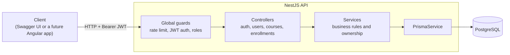
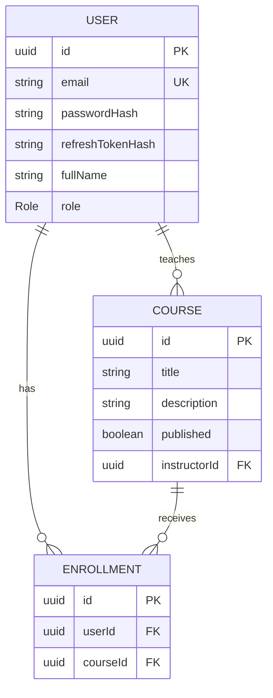
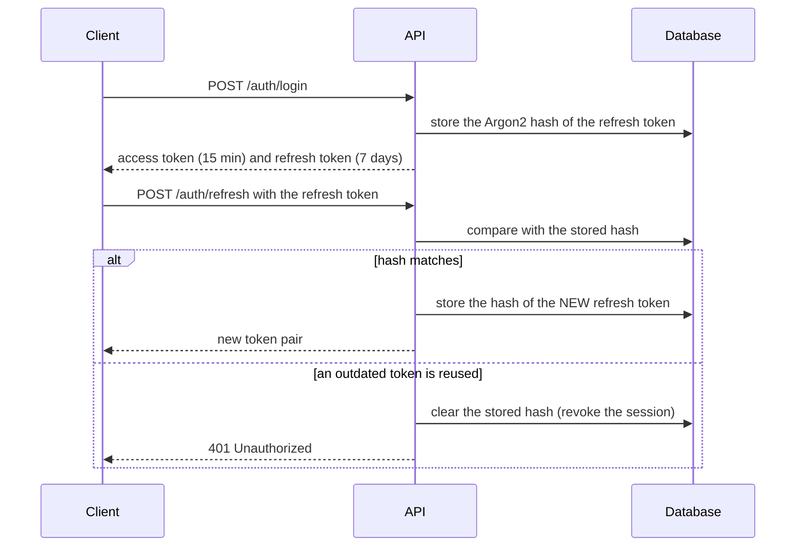

# LearnHub


A learning-platform backend with secure authentication, role-based access control (RBAC), courses and enrollments. It is a portfolio rebuild of the kind of platform I delivered end to end as the sole developer for educational clients.

## Live demo

**API documentation (Swagger UI): https://learnhub-tsdv.onrender.com/docs**

> The demo runs on free tiers (Render for the API, Neon for PostgreSQL). After a period of inactivity the API goes to sleep, so the **first request can take about a minute** while it wakes up. After that it responds normally.

Try it in four steps:

1. Open the docs link above and call `POST /api/auth/login` with one of the demo accounts below.
2. Copy the `accessToken` from the response.
3. Press **Authorize** at the top of the page and paste the token.
4. Call any endpoint. What you can see and do depends on the account's role.

| Role | Email | Password |
|---|---|---|
| Student | `student@learnhub.dev` | `Student12345!` |
| Instructor | `instructor@learnhub.dev` | `Instructor12345!` |

These accounts are public on purpose. The demo courses are restored every time the API starts. There is no public admin account: you can also register your own student account with `POST /api/auth/register`.

Things worth trying:

- Log in as the student: you only see published courses, and the draft course answers `404`.
- Log in as the instructor: you can create courses and see your draft, but editing a course you do not own returns `403`.
- Reuse an old refresh token after calling `POST /api/auth/refresh`: the session is revoked.

## Features

- **Authentication:** registration, login, short-lived access tokens and rotating refresh tokens.
- **Role-based access control:** `STUDENT`, `INSTRUCTOR` and `ADMIN`, enforced by guards and by ownership checks in the service layer.
- **Courses:** CRUD with pagination and case-insensitive title search; drafts stay hidden from students.
- **Enrollments:** students enroll and leave; instructors see the roster of their own courses.
- **Role management:** only admins can change roles, and never their own.
- **API documentation:** interactive Swagger UI at `/docs`.
- **Containerized and deployed:** multi-stage Docker image (non-root, with healthcheck), a one-command Compose stack and a public deployment.
- **Quality gates:** unit tests, end-to-end tests against a real PostgreSQL, and CI on every pull request.

## Tech stack

| Area | Technology |
|---|---|
| Language / framework | TypeScript, NestJS |
| Database / ORM | PostgreSQL 16, Prisma |
| Security | Argon2, JWT (access + refresh), rate limiting, DTO validation |
| Documentation | OpenAPI / Swagger |
| Testing | Jest, Supertest |
| Tooling | pnpm, Docker, Docker Compose, GitHub Actions |
| Hosting | Render (API), Neon (PostgreSQL) |

## Architecture



### Data model



### Refresh token rotation



## Permission matrix

| Action | Student | Instructor | Admin |
|---|:---:|:---:|:---:|
| Register, log in, refresh | public | public | public |
| View published courses | yes | yes | yes |
| View draft courses | no | own | all |
| Create a course | no | yes | yes |
| Edit or delete a course | no | own | any |
| Enroll in / leave a course | yes | no | no |
| View a course roster | no | own | any |
| List users | no | no | yes |
| Change a user role | no | no | yes (not their own) |

## API overview

Interactive documentation is available at `/docs` (locally `http://localhost:3000/docs`).

| Method | Path | Access |
|---|---|---|
| GET | `/api/health/live` | public (liveness, no database) |
| GET | `/api/health` | public (readiness, checks the database) |
| POST | `/api/auth/register` | public (rate limited) |
| POST | `/api/auth/login` | public (rate limited) |
| POST | `/api/auth/refresh` | public |
| POST | `/api/auth/logout` | authenticated |
| GET | `/api/users/me` | authenticated |
| GET | `/api/users` | admin |
| PATCH | `/api/users/:id/role` | admin |
| GET | `/api/courses` | authenticated (paginated, `?search=`) |
| GET | `/api/courses/:id` | authenticated (visibility rules apply) |
| POST | `/api/courses` | instructor, admin |
| PATCH / DELETE | `/api/courses/:id` | owner, admin |
| POST / DELETE | `/api/courses/:id/enroll` | student |
| GET | `/api/courses/:id/students` | owner, admin |
| GET | `/api/enrollments/me` | student |

## Getting started

### Option A: everything in Docker (one command)

**Prerequisites:** Docker Desktop and Git.

```bash
git clone https://github.com/AlexisJFranco1575/learnhub.git
cd learnhub

cp .env.example .env
# Edit .env: set two DIFFERENT random secrets and an admin password (10+ characters).
# Generate each secret with:
#   node -e "console.log(require('crypto').randomBytes(48).toString('hex'))"

docker compose --profile full up --build
```

The API runs at `http://localhost:3000/api` and the docs at `http://localhost:3000/docs`. On startup the container applies the database migrations and creates the admin user from your `.env`. Demo data is only created if you set `SEED_DEMO_DATA=true`, because the image runs with `NODE_ENV=production`.

Stop it with `docker compose --profile full down` (add `-v` to also delete the database volume).

### Option B: local development

**Prerequisites:** Node.js 24 (see `.nvmrc`), pnpm, Docker Desktop and Git.

```bash
git clone https://github.com/AlexisJFranco1575/learnhub.git
cd learnhub

# 1. Start PostgreSQL only
docker compose up -d

# 2. Configure the API
cd apps/api
cp .env.example .env
# Edit .env and set two DIFFERENT random secrets (command above).

# 3. Install, migrate, seed and run
pnpm install
pnpm prisma migrate deploy
pnpm db:seed
pnpm start:dev
```

Outside production the seed also creates the demo instructor and student listed above, plus three demo courses. These credentials are for demos and local development only.

## Configuration

| Variable | Required | Description |
|---|:---:|---|
| `DATABASE_URL` | yes | PostgreSQL connection string |
| `JWT_ACCESS_SECRET` | yes | Secret for access tokens (32+ characters) |
| `JWT_REFRESH_SECRET` | yes | A different secret for refresh tokens (32+ characters) |
| `JWT_ACCESS_TTL_SECONDS` | yes | Access token lifetime (`900` = 15 minutes) |
| `JWT_REFRESH_TTL_SECONDS` | yes | Refresh token lifetime (`604800` = 7 days) |
| `SEED_ADMIN_EMAIL` | no | Admin email created by the seed |
| `SEED_ADMIN_PASSWORD` | in production | Admin password; the seed refuses to run in production without 10+ characters |
| `SEED_DEMO_DATA` | no | `true` creates the demo users and courses even in production |
| `TRUST_PROXY` | no | Number of reverse proxies in front of the app (`1` on Render), so rate limiting sees real client IPs |
| `CORS_ORIGIN` | no | Comma-separated list of allowed frontend origins |
| `PORT` | no | HTTP port (default `3000`) |

The app refuses to start when a required secret is missing or too short.

## Scripts

Run these from `apps/api`.

| Command | What it does |
|---|---|
| `pnpm start:dev` | Run the API in watch mode |
| `pnpm build` | Compile the project |
| `pnpm test` | Unit tests (database mocked) |
| `pnpm test:e2e` | End-to-end tests against the real PostgreSQL |
| `pnpm db:seed` | Create the admin user and demo data (idempotent) |

## Docker image

The image is built in three stages (see `apps/api/Dockerfile`):

1. **base:** Node 24 (slim), pnpm and OpenSSL.
2. **build:** all dependencies, Prisma client generation and TypeScript compilation.
3. **runtime:** production dependencies and the compiled output only, running as the non-root `node` user, with a liveness healthcheck.

The container entrypoint applies pending migrations, makes sure the admin user exists and then starts the API, so the same image works locally and in the cloud with no extra commands.

## Deployment

The public demo uses free tiers:

- **API:** a Render web service built from `apps/api/Dockerfile`, with auto-deploy from `main`. Its health check uses `/api/health/live`.
- **Database:** Neon serverless PostgreSQL, using a direct (non-pooled) connection string for Prisma.
- **Configuration:** every setting comes from environment variables listed above; no secrets are stored in the repository or the image.

The liveness endpoint does not touch the database, so health probes never keep the serverless database awake.

## Testing strategy

- **Unit tests** cover services and guards with a mocked database: business rules, ownership checks and error mapping.
- **End-to-end tests** boot the whole application against PostgreSQL and exercise the real HTTP surface: authentication, token rotation and reuse detection, role checks, course visibility, pagination and enrollment rules. Each run creates uniquely named data and removes only what it created.
- **CI** runs build, unit tests, migrations and e2e tests on every pull request, with PostgreSQL as a service container. A second job builds the production Docker image and checks its contents and user.

## Design decisions

- **Argon2** for password hashing, following current OWASP guidance.
- **Two secrets, two lifetimes:** short-lived access tokens and longer-lived refresh tokens signed with different secrets.
- **Refresh tokens are hashed at rest and rotated on every use.** Reusing an outdated token revokes the session, which limits the damage of a stolen token.
- **Secure by default:** every route requires authentication unless it is explicitly marked `@Public()`.
- **Two authorization layers:** role guards decide which endpoints a role may call; services decide which resources a user may touch.
- **Visibility is enforced inside the database query**, so data a user must not see is never loaded.
- **Hidden resources answer 404, not 403**, so their existence is not revealed.
- **Fail fast on configuration:** the app refuses to start when a required secret is missing or too short, and the seed refuses to create a production admin without a strong password.
- **Registration always creates a `STUDENT`;** promotions go through an admin.
- **Multi-stage, non-root container** with no secrets baked into the image.
- **Liveness and readiness are separate endpoints,** so a database outage does not restart healthy containers.
- **Explicit proxy trust:** `TRUST_PROXY` is a number of hops, not a blanket setting, so clients cannot spoof their IP to dodge rate limits.

## Known limitations

- One active session per user: logging in on a second device invalidates the first device's refresh token. A dedicated `RefreshToken` table would lift this.
- A role change takes effect when the access token is renewed (at most 15 minutes).
- Rate limiting is in memory; running several instances would need a shared store such as Redis.
- The public demo runs on free tiers: it sleeps when idle and is not meant for production traffic.

## Roadmap

- [x] Authentication, refresh token rotation and RBAC
- [x] Courses, enrollments, role management and Swagger docs
- [x] Unit tests, e2e tests and CI
- [x] Production Docker image and full-stack Compose file
- [x] Public deployment
- [ ] Angular frontend
- [ ] Multi-session refresh tokens

## License

[MIT](LICENSE)