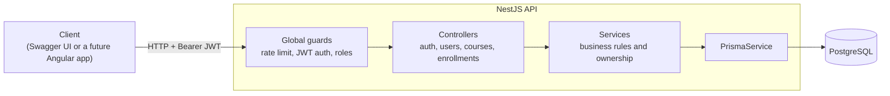
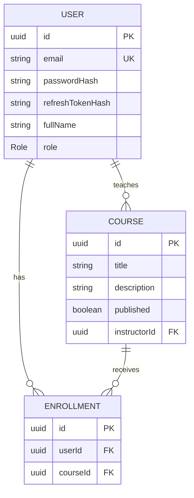
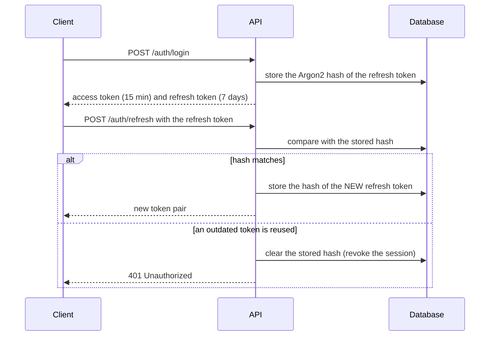

# LearnHub


A learning-platform backend with secure authentication, role-based access control (RBAC), courses and enrollments. It is a portfolio rebuild of the kind of platform I delivered end to end as the sole developer for educational clients.

## Features

- **Authentication:** registration, login, short-lived access tokens and rotating refresh tokens.
- **Role-based access control:** `STUDENT`, `INSTRUCTOR` and `ADMIN`, enforced by guards and by ownership checks in the service layer.
- **Courses:** CRUD with pagination and case-insensitive title search; drafts stay hidden from students.
- **Enrollments:** students enroll and leave; instructors see the roster of their own courses.
- **Role management:** only admins can change roles, and never their own.
- **API documentation:** interactive Swagger UI at `/docs`.
- **Quality gates:** unit tests, end-to-end tests against a real PostgreSQL, and CI on every pull request.

## Tech stack

| Area | Technology |
|---|---|
| Language / framework | TypeScript, NestJS |
| Database / ORM | PostgreSQL 16, Prisma |
| Security | Argon2, JWT (access + refresh), rate limiting, DTO validation |
| Documentation | OpenAPI / Swagger |
| Testing | Jest, Supertest |
| Tooling | pnpm, Docker Compose, GitHub Actions |

## Architecture



### Data model



### Refresh token rotation



## Permission matrix

| Action | Student | Instructor | Admin |
|---|:---:|:---:|:---:|
| Register, log in, refresh | public | public | public |
| View published courses | yes | yes | yes |
| View draft courses | no | own | all |
| Create a course | no | yes | yes |
| Edit or delete a course | no | own | any |
| Enroll in / leave a course | yes | no | no |
| View a course roster | no | own | any |
| List users | no | no | yes |
| Change a user role | no | no | yes (not their own) |

## API overview

Interactive documentation is available at `http://localhost:3000/docs`.

| Method | Path | Access |
|---|---|---|
| GET | `/api/health` | public |
| POST | `/api/auth/register` | public (rate limited) |
| POST | `/api/auth/login` | public (rate limited) |
| POST | `/api/auth/refresh` | public |
| POST | `/api/auth/logout` | authenticated |
| GET | `/api/users/me` | authenticated |
| GET | `/api/users` | admin |
| PATCH | `/api/users/:id/role` | admin |
| GET | `/api/courses` | authenticated (paginated, `?search=`) |
| GET | `/api/courses/:id` | authenticated (visibility rules apply) |
| POST | `/api/courses` | instructor, admin |
| PATCH / DELETE | `/api/courses/:id` | owner, admin |
| POST / DELETE | `/api/courses/:id/enroll` | student |
| GET | `/api/courses/:id/students` | owner, admin |
| GET | `/api/enrollments/me` | student |

## Getting started

**Prerequisites:** Node.js 22, pnpm, Docker Desktop and Git.

```bash
git clone https://github.com/AlexisJFranco1575/learnhub.git
cd learnhub

# 1. Start PostgreSQL
docker compose up -d

# 2. Configure the API
cd apps/api
cp .env.example .env
# Edit .env and set two DIFFERENT random secrets. Generate each one with:
#   node -e "console.log(require('crypto').randomBytes(48).toString('hex'))"

# 3. Install, migrate, seed and run
pnpm install
pnpm prisma migrate deploy
pnpm db:seed
pnpm start:dev
```

The API runs at `http://localhost:3000/api` and the docs at `http://localhost:3000/docs`.

The seed creates an admin (`SEED_ADMIN_EMAIL` / `SEED_ADMIN_PASSWORD` from your `.env`) and, outside production, a demo instructor (`instructor@learnhub.dev` / `Instructor12345!`) with three demo courses. These demo credentials are for local development only.

## Scripts

Run these from `apps/api`.

| Command | What it does |
|---|---|
| `pnpm start:dev` | Run the API in watch mode |
| `pnpm build` | Compile the project |
| `pnpm test` | Unit tests (database mocked) |
| `pnpm test:e2e` | End-to-end tests against the real PostgreSQL |
| `pnpm db:seed` | Create the admin user and demo data (idempotent) |

## Testing strategy

- **Unit tests** cover services and guards with a mocked database: business rules, ownership checks and error mapping.
- **End-to-end tests** boot the whole application against PostgreSQL and exercise the real HTTP surface: authentication, token rotation and reuse detection, role checks, course visibility, pagination and enrollment rules. Each run creates uniquely named data and removes only what it created.
- **CI** runs build, unit tests, migrations and e2e tests on every pull request, with PostgreSQL as a service container.

## Design decisions

- **Argon2** for password hashing, following current OWASP guidance.
- **Two secrets, two lifetimes:** short-lived access tokens and longer-lived refresh tokens signed with different secrets.
- **Refresh tokens are hashed at rest and rotated on every use.** Reusing an outdated token revokes the session, which limits the damage of a stolen token.
- **Secure by default:** every route requires authentication unless it is explicitly marked `@Public()`.
- **Two authorization layers:** role guards decide which endpoints a role may call; services decide which resources a user may touch.
- **Visibility is enforced inside the database query**, so data a user must not see is never loaded.
- **Hidden resources answer 404, not 403**, so their existence is not revealed.
- **Fail fast on configuration:** the app refuses to start when a required secret is missing or too short.
- **Registration always creates a `STUDENT`;** promotions go through an admin.

## Known limitations

- One active session per user: logging in on a second device invalidates the first device's refresh token. A dedicated `RefreshToken` table would lift this.
- A role change takes effect when the access token is renewed (at most 15 minutes).
- Rate limiting is in memory; running several instances would need a shared store such as Redis.

## Roadmap

- [x] Authentication, refresh token rotation and RBAC
- [x] Courses, enrollments, role management and Swagger docs
- [x] Unit tests, e2e tests and CI
- [ ] Production Docker image and full-stack Compose file
- [ ] Public deployment
- [ ] Angular frontend
- [ ] Multi-session refresh tokens

## License

[MIT](LICENSE)